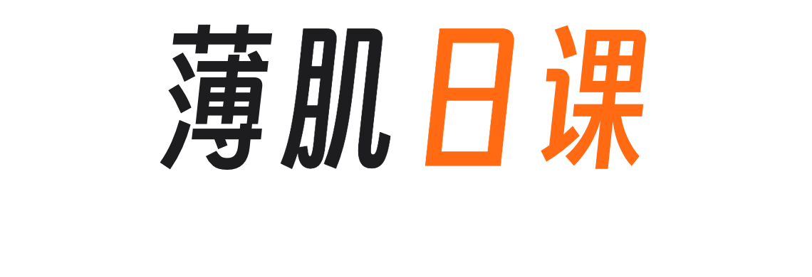
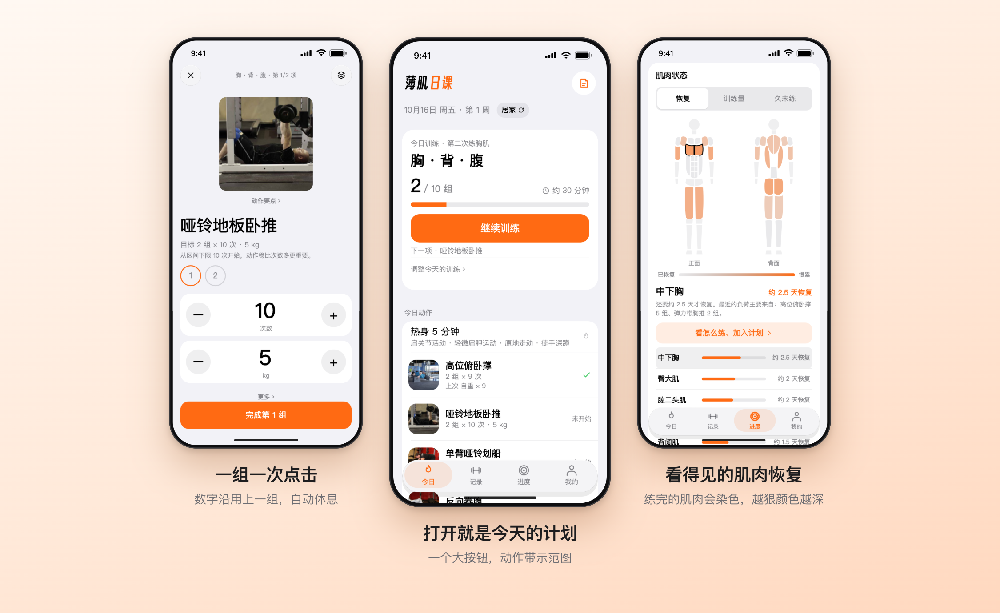
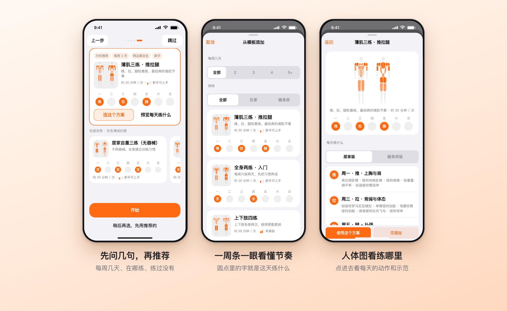
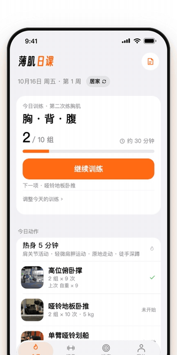
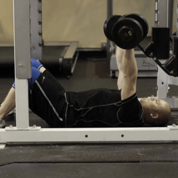
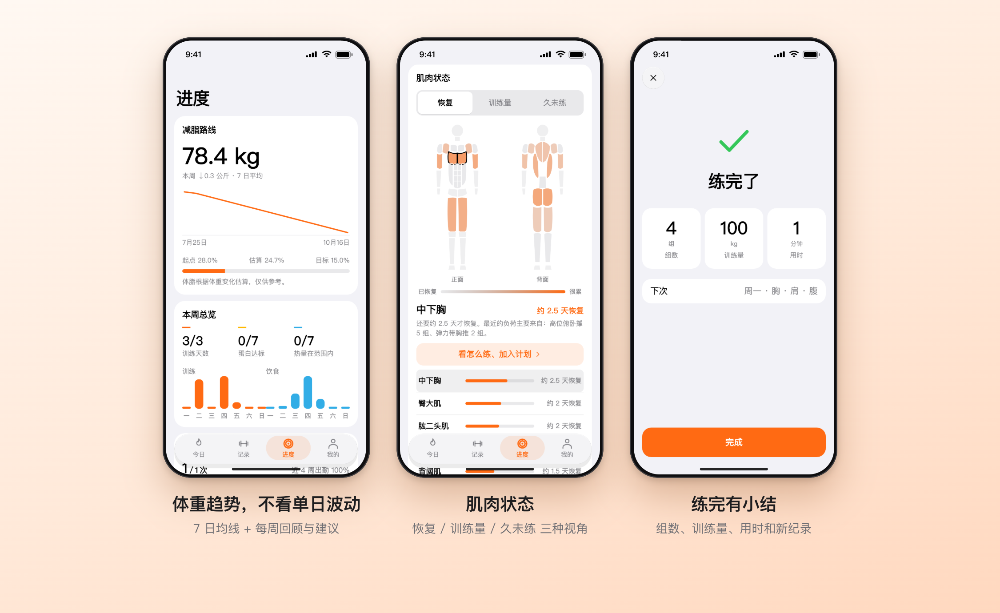
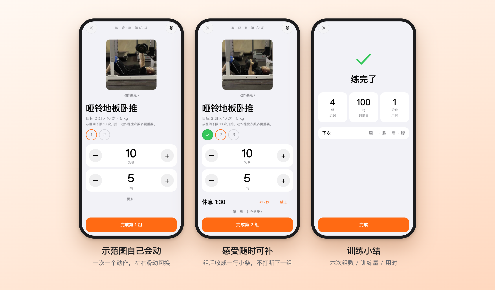
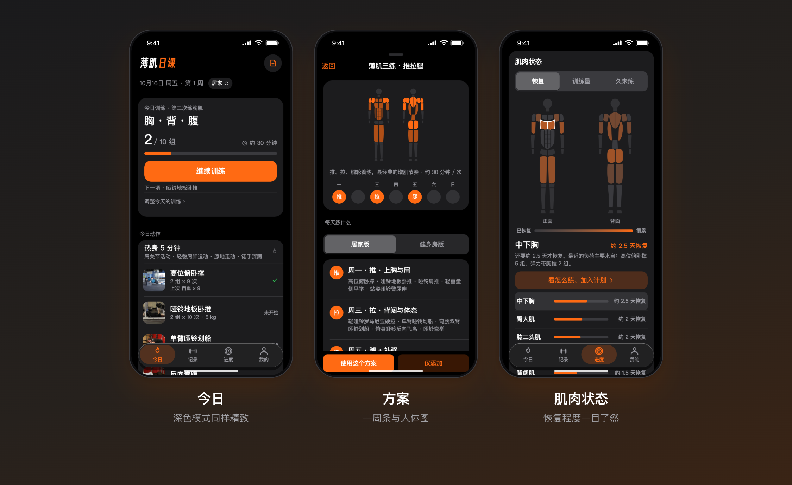
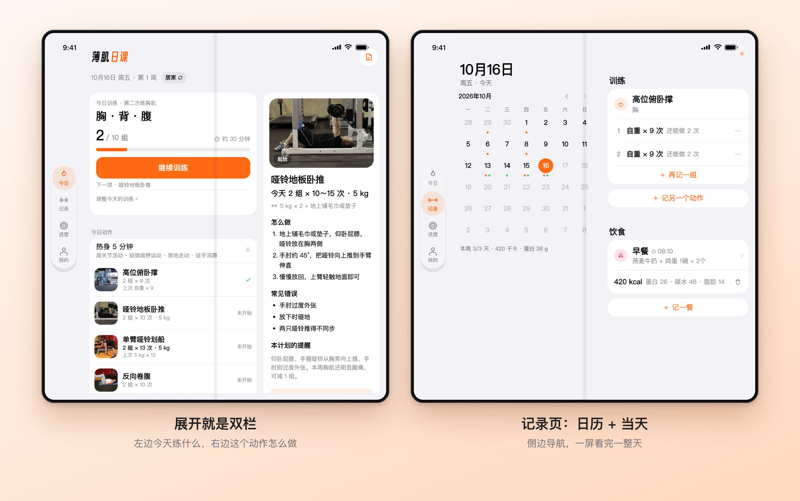

<div align="center">

<picture>
  <source media="(prefers-color-scheme: dark)" srcset="docs/images/wordmark-dark.png">
  
</picture>

**按你的身材，给你一份练得出薄肌的计划。然后陪你，一周一周练上去。**

免费 · 开源 · 没有广告 · 没有账号 · 数据只在你的手机里

[](LICENSE)
[](#安装)
[](https://flutter.dev)
[](#开发)
[](PRIVACY.md)
[](PRIVACY.md)

[简体中文](README.md) · [English](README.en.md)



</div>

---

## 这是什么

**薄肌日课（LeanDaily）** 是一个专注"薄肌"人群的训练 + 饮食记录 App。

"薄肌"不是练得越壮越好，而是**低体脂 + 匀称、有线条的肌肉**。每个人的起点不一样：有的人体脂偏高，要先减脂；有的人偏瘦，要先吃够、练上去；还有的人已经有些基础，想把肩背腹练得更精致。所以 LeanDaily 做的第一件事不是塞给你一份固定计划，而是：

> **先问你几个问题 → 算出你的路线、每日热量和蛋白目标 → 推荐一份适合你的训练方案 → 之后每次训练，根据你的表现自动调整目标。**

它是一个完整的离线 App，没有账号、没有广告、没有统计，也没有服务器。

## 亮点

### ① 先问几句，再推荐：不用自己挑方案

大多数训练 App 一上来就丢给你十几个文字方案，新手根本看不出区别。LeanDaily 反过来：先问你**每周几天、在哪练**（在家无哑铃 / 在家有哑铃 / 健身房 / 两边都去）、**练过没有**，再给你**一张推荐卡**，其余适合的方案横向滑动对比。

每个方案都是一张"指纹卡"，不用读说明就能看懂：

- **一周条**：7 个小圆点，训练日点亮，圆里写这天练什么（推 / 拉 / 腿 / 全 / 上 / 下），"每周几天、怎么排"一眼看懂；
- **迷你人体图**：用真实动作数据算出每周各肌肉的训练量并染色，一眼看到"练的是哪里"；
- **一句话简介 + 适合谁**：不用再读一大段说明。



### ② 打开就是今天的计划，示范图会动

选好方案之后，没有层层菜单。打开 App 就是今天练什么、练多少组、下一个动作是什么，一个大按钮"继续训练"。每个动作都带真人示范图，在训练界面里自己循环播放，不用点开。

<div align="center">

&nbsp;&nbsp;&nbsp;

</div>

### ③ 看得见的进度，看得见的恢复

- **肌肉状态**：人体图按"恢复 / 训练量 / 久未练"三种视角染色。练完的肌肉会变深，恢复了会变浅，一眼知道今天该练哪里、哪块肌肉太久没练；点一块肌肉还能直接看"怎么练"并加进计划。
- **体重趋势**：7 日均线 + 每周变化，不被单日波动带偏；按你的路线给出体脂估算与目标进度。
- **每周回顾**：每周一汇总上周的训练、蛋白、热量和体重，给出"下周怎么调"，并且可以一键应用（比如每日热量 ±100 千卡）。



### ④ 为训练设计的训练模式

一次一个动作，一组一次点击：数字沿用上一组，自动开始休息倒计时。"还能做几次""有没有不舒服"做成可选的小标签，不打断节奏，事后也能随时补。整页左右滑动切换动作，练完给小结。



### ⑤ 有依据的进阶规则（全部写死的规则，没有"黑盒 AI"）

加多少重量、什么时候加，是训练 App 最容易做错的地方。LeanDaily 用一套**可解释、可测试**的规则：

| 场景 | 做法 |
| --- | --- |
| 次数进阶 | 在次数区间内，**连续达标**就加 1 次；新手每次达标即加，老手要求更稳 |
| 升级难度 | 做满上限且有余力，才建议换更难的变式或加重量；涨幅超过 10% 提示偏大，超过 15% 不给一键接受 |
| 器材步长 | 按器材给默认步长：健身房哑铃 2 kg（10 kg 以下 1 kg）、杠铃/器械 2.5 kg；居家固定哑铃走"加次数→换变式" |
| 疼痛与变形 | 标记疼痛后连续两次不加量并提示就医；动作变形则保持目标 |
| 状态不好 | "有点累 / 不舒服"当天不计入进度，不算失败 |
| 断练回归 | 隔 14 天以上回来，目标自动降 2 次、少 1 组 |
| 减载 | 连续训练且疲劳累积或多个动作停滞时，**只提示**"这周可以减量一周"，你点了才生效 |
| 成长期（未满 18 岁） | 不建议加重量、不加组，也没有热量缺口建议 |
| 减脂期 | 力量不降就是成功，停滞不触发加组 |

规则全文见 [docs/PROGRESSION.md](docs/PROGRESSION.md)。仓库里还有 **26 周长期模拟测试**：模拟认真练的新手、停滞的人、受伤的人、断练后回来的人，检查规则不会推荐出荒谬的结果。

### ⑥ 饮食记录，够用不啰嗦

- **每日热量 + 蛋白目标**：按性别、年龄、身高、体重、体脂、活动量用 Mifflin-St Jeor 公式估算，带**安全下限**（热量不低于基础代谢和 1200/1500 千卡；目标体脂男不低于 8%、女不低于 16%）。
- **快速记饮食**：内置约 300 种常见食物，高蛋白排行、常吃一键添加，手动输入也行。
- **拍照识别（可选）**：自己填一个兼容 OpenAI 接口的大模型服务，拍一张饮食照片即可估算热量和蛋白。**不填就永远不会联网**。

### ⑦ 暗色、折叠屏、无障碍

深色模式同样精致；横屏/折叠屏内屏有侧边导航和双栏布局；支持系统字体放大和"减弱动态效果"；所有动画可被打断。



折叠屏展开后自动切到侧边导航和双栏：左边是今天的计划，右边是选中动作的做法和注意事项。



## 隐私承诺

- **没有账号，没有登录。**
- **没有广告、没有统计、没有崩溃上报、没有任何第三方追踪组件。**
- 训练、饮食、体重、照片**只保存在你的手机本地**；系统云备份已关闭。
- 只有两种情况会联网，且都由你控制：你自己配置的拍照识别接口，以及检查更新（可在"我的 → 关于"里关闭）。

完整内容见 [PRIVACY.md](PRIVACY.md)，App 内"我的 → 关于 → 隐私政策"也有同一份，离线可读。

## 安装

> 目前提供 Android（8.0 及以上，64 位 ARM 手机）安装包。

iOS 源码已支持本地构建，最低 iOS 15；暂未提供 TestFlight / App Store 发行。构建与验收见 [iOS 开发说明](docs/IOS.md)。

1. 到 [Releases](../../releases) 页面下载最新的 `LeanDaily-x.y.z-arm64.apk`；
2. 在手机上允许"安装未知来源应用"，点开 APK 安装。

**从旧版"薄肌日课"迁移**：在旧版"我的 → 备份与高级"导出备份，在新版同一位置导入即可，新版可以直接读取旧备份。

## 开发

需要 [Flutter](https://flutter.dev) 3.47+（Dart 3.13+）、JDK 17+、Android SDK 与 NDK。

```bash
git clone https://github.com/Hunter-Ght/LeanDaily.git
cd LeanDaily
flutter pub get
flutter run                      # 连接手机或模拟器

# 静态检查与测试（测试需固定时区）
flutter analyze
bash tool/lint_tokens.sh         # 界面代码不得写死颜色、不得使用 Material 外观控件
TZ=Asia/Shanghai flutter test
```

**构建发布包**（用你自己的签名）：

```bash
export LEANDAILY_STORE_FILE=/path/to/your.jks
export LEANDAILY_SIGNING_PASSWORD=...
export LEANDAILY_KEY_ALIAS=leandaily        # 默认 leandaily
flutter build apk --release --target-platform android-arm64
python3 tool/check_apk.py build/app/outputs/flutter-apk/app-release.apk   # 发布前检查
```

没有设置签名变量时会回退到调试签名，仅供本机试跑。**请勿把 `.jks`、密码提交到仓库。**

> **注意**：发布构建必须保持 R8 混淆关闭（`isMinifyEnabled = false`）。Flutter 引擎会按类名回调 `FlutterJNI`，被混淆后引擎无法启动。

### 项目链接与发布

[`lib/config/app_links.dart`](lib/config/app_links.dart) 已配置：

| 常量 | 地址 |
| --- | --- |
| `updateCheckUrl` | `https://api.github.com/repos/Hunter-Ght/LeanDaily/releases/latest` |
| `privacyPolicyUrl` | [在线隐私政策](https://github.com/Hunter-Ght/LeanDaily/blob/main/PRIVACY.md) |
| `repoUrl` | [项目主页](https://github.com/Hunter-Ght/LeanDaily) |

隐私政策中的联系方式为 [Issues](https://github.com/Hunter-Ght/LeanDaily/issues)。推送 `PRIVACY.md` 到 `main` 后即可在线阅读，无需部署 GitHub Pages。

安装包从 [Releases](https://github.com/Hunter-Ght/LeanDaily/releases) 下载。普通 `git push` 不会自动生成 APK 或 Release；构建、签名和上传步骤见 [发布清单](docs/RELEASING.md)。

### 项目结构

```
lib/
├─ domain/    纯 Dart 业务规则：计划、进阶、肌肉恢复、饮食、体重趋势、每周回顾
├─ data/      本地存储、备份、提醒、拍照识别、检查更新
├─ app/       AppController、路由、外壳（四标签）
├─ ui/        界面：today / log / stats / me / training / sheets / onboarding / kit
└─ theme/     颜色与尺寸令牌
android/      极薄的原生层（存储、通知、照片、网络）
test/         1100+ 个测试（含和旧实现对照的"金标"数据）
docs/         架构、进阶规则、设计原则、数据安全说明
```

iOS 构建、签名与验收说明见 [docs/IOS.md](docs/IOS.md)。

更多见 [docs/ARCHITECTURE.md](docs/ARCHITECTURE.md) 和 [docs/DESIGN.md](docs/DESIGN.md)。

## 路线图

- [ ] 自重动作的进阶阶梯（深蹲 / 反向划船 / 臀桥 / 卷腹）
- [ ] 计划升级建议（稳定训练 8 周后推荐更高阶方案）
- [ ] 估算 1RM 作为统一的力量指标
- [ ] 英文界面与更多语言
- [ ] iOS 版本真机验收与发行（Swift 原生层已实现，见 [iOS 开发说明](docs/IOS.md)）

欢迎提 Issue 和 PR，见 [CONTRIBUTING.md](CONTRIBUTING.md)。

## 致谢

- 动作示范图来自开源动作库 [free-exercise-db](https://github.com/yuhonas/free-exercise-db)（Unlicense，公共领域）。
- 字标使用开源字体 [得意黑 Smiley Sans](https://github.com/atelier-anchor/smiley-sans)（SIL OFL 1.1）的 4 字子集。
- 界面使用 [Flutter](https://flutter.dev) 构建。

详见 [docs/THIRD_PARTY.md](docs/THIRD_PARTY.md)。

## 免责声明

LeanDaily 中的热量与蛋白目标、体脂估算和训练建议，都是按你填写的信息用固定规则算出的**一般性参考**，**不是医疗建议**，也不能替代医生、营养师或专业教练的意见。身体不适、疼痛、有慢性病、怀孕或恢复期时请先咨询医生。食物库的热量与营养数值为常见量级的**估算**，品牌与做法不同会有差别。

## 许可证

[MIT](LICENSE) © 2026 Hunter-Ght
